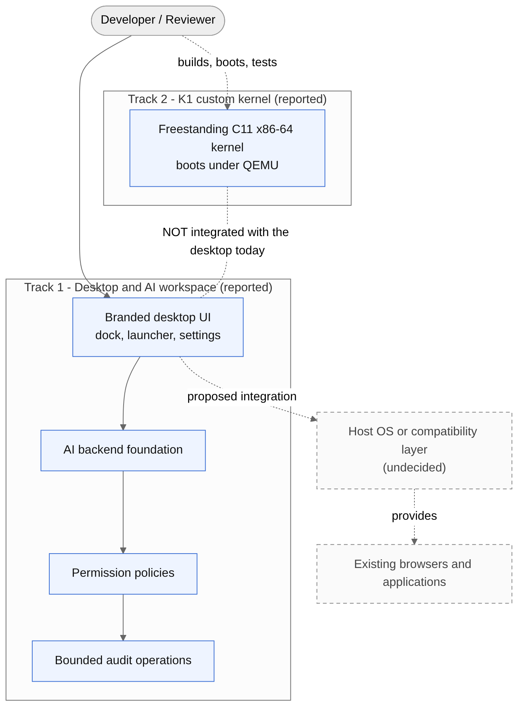
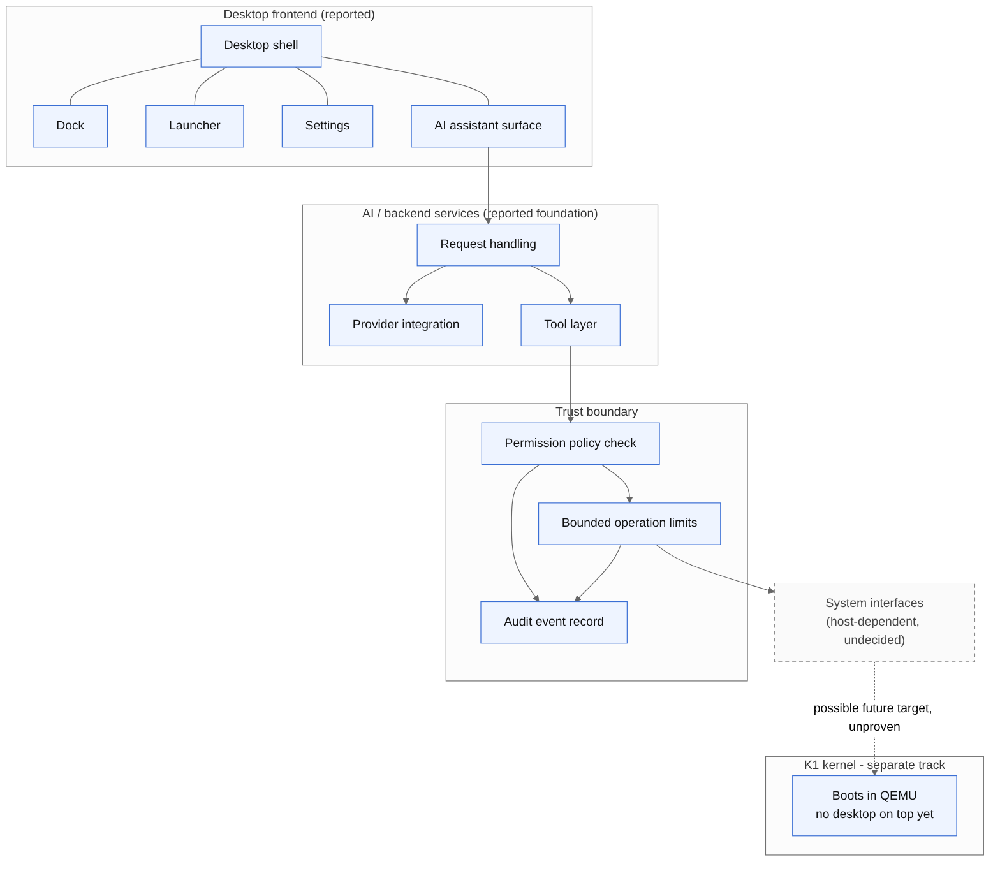
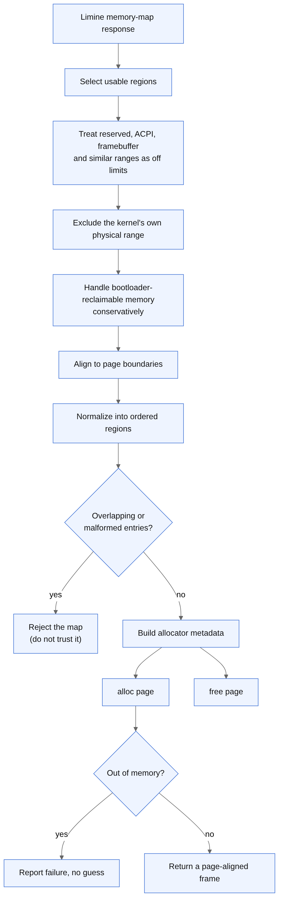
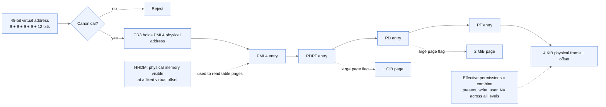
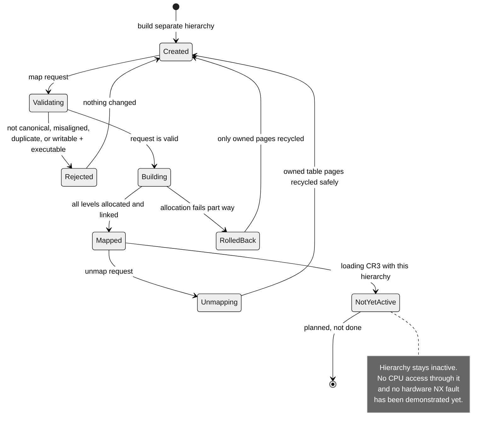
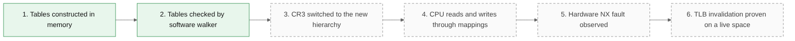
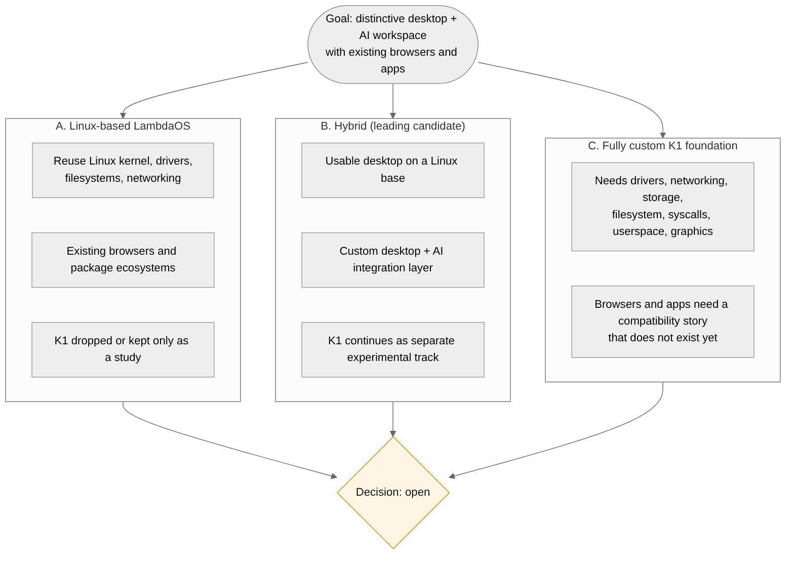
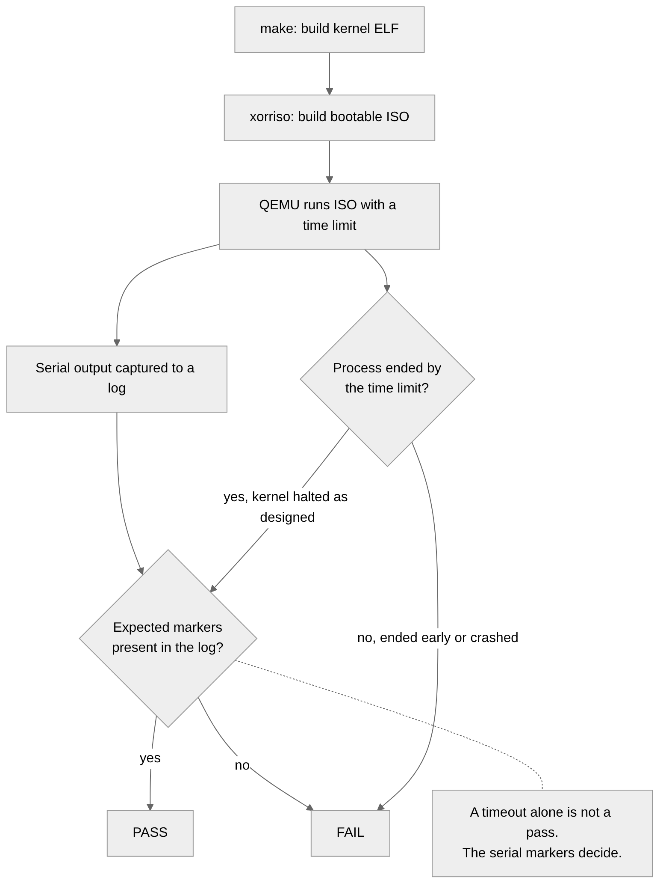

# ΛOS (LambdaOS)

### Think. Build. Compute.

An experimental, AI-native operating system and developer workspace. It combines a hand-written x86-64 kernel track (K1) with a modern desktop and AI workspace track.

> **About this repository.** This is the public showcase for ΛOS. It contains documentation, diagrams and engineering write-ups only. The implementation source is not published here while the project is in active development. Everything below is written to be honest about what exists, what is experimental, and what is still only a plan. See [How to read the status labels](#how-to-read-the-status-labels).

---

## Contents

1. [What is ΛOS?](#what-is-λos)
2. [Why it exists](#why-it-exists)
3. [Status at a glance](#status-at-a-glance)
4. [Two tracks, one vision](#two-tracks-one-vision)
5. [Feature matrix](#feature-matrix)
6. [Architecture](#architecture)
7. [K1 kernel: low-level design](#k1-kernel-low-level-design)
8. [AI workspace and security model](#ai-workspace-and-security-model)
9. [Product direction: Linux, hybrid or custom?](#product-direction-linux-hybrid-or-custom)
10. [Development journey: slices 0G to 0L](#development-journey-slices-0g-to-0l)
11. [How the kernel is tested](#how-the-kernel-is-tested)
12. [Hard engineering problems](#hard-engineering-problems)
13. [Known limitations and open decisions](#known-limitations-and-open-decisions)
14. [Roadmap](#roadmap)
15. [Technology](#technology)
16. [Documentation map](#documentation-map)
17. [Screenshots](#screenshots)
18. [Contributing, security and license](#contributing-security-and-license)
19. [Author](#author)

---

## What is ΛOS?

ΛOS is an experimental operating-system project with two complementary directions:

1. **A desktop and AI developer workspace.** A branded desktop with a dock, launcher and settings, plus the foundation of an AI backend that works through permission policies and bounded, audited operations.
2. **A custom x86-64 kernel called K1.** A freestanding C11 kernel, booted with the Limine protocol and tested under QEMU, built one verified slice at a time.

The goal is a coherent, developer-oriented computing experience: a distinctive desktop, an AI assistant that can do real work through controlled interfaces, and a low-level understanding of how the machine underneath actually works.

ΛOS is **not** a finished general-purpose operating system, and it does **not** claim to be. It is a serious engineering project in active development, and this showcase is meant to let people see how it is being built.

## Why it exists

Three ideas meet in this project.

**Developer tools are fragmented.** A typical developer workflow spans a desktop, a browser, a terminal, editors and, now, AI assistants that often sit outside the system and cannot safely touch it. ΛOS explores a workspace where these pieces share one identity and one set of rules.

**AI that acts needs boundaries.** An assistant that only answers questions is easy to trust. An assistant that can perform operations needs explicit permissions, limits and an audit trail. ΛOS treats those as design requirements from the start, not as add-ons.

**Systems knowledge compounds.** Writing a kernel forces a precise understanding of boot, CPU exceptions, memory and isolation. The K1 track exists to build that understanding in public, with reproducible evidence at every step.

The project deliberately avoids two traps: building a new browser engine, and building a proprietary app store. The intended experience uses established browsers and existing application ecosystems wherever the underlying platform allows it.

## Status at a glance

| Area | State |
|---|---|
| K1 boots under QEMU with Limine | Reported working |
| CPU exception handling (IDT, normalized frames) | Reported working |
| GDT, TSS and double-fault IST | Reported working |
| Physical page allocator | Reported working |
| Read-only four-level page-table inspection | Reported working |
| Owned page-table mapper (inactive address space) | Experimental |
| Switching the CPU to the new address space | Not done |
| Desktop UI, AI backend foundation, permissions, audit | Reported, under development |
| Desktop running on K1 | **Not integrated** |
| Browsers and ordinary apps | Planned, depends on the platform decision |

### How to read the status labels

| Label | Meaning |
|---|---|
| **Reported working** | The author reports this working, with QEMU test evidence for the kernel parts. |
| **Experimental** | Implemented, deliberately isolated, and not yet safe or proven to activate. |
| **Planned** | Not started, or only designed. |
| **Open decision** | Depends on an architecture choice that has not been made. |

Nothing in this showcase is labelled stronger than the evidence supports. In particular, building a page table, inspecting a page table, and the CPU actually running through a page table are three different levels of proof. See [Verification levels](docs/05-virtual-memory.md#verification-levels).

## Two tracks, one vision

The two tracks share design goals (small verified steps, explicit boundaries, honest limits) but they are **separate today**. The desktop does not run on K1. A custom kernel does not automatically run Chrome, Edge, Firefox or Linux applications, and this showcase never implies that it does.

## Feature matrix

| Feature or subsystem | Purpose | Status | Evidence or limitation |
|---|---|---|---|
| Branded desktop shell | Distinct visual identity and workflow | Reported, under development | Screenshots pending, see [capture plan](docs/14-screenshots-and-evidence.md) |
| Dock, launcher, settings | Core desktop navigation and configuration | Reported, under development | Interaction depth not independently verified here |
| AI backend foundation | Request handling and tool calls | Reported, under development | Provider and interface details not published |
| Permission policies | Decide which tool calls are allowed | Reported, under development | Coverage of every route and tool is not claimed |
| Bounded audit operations | Limit and record consequential actions | Reported, under development | See [AI security model](docs/06-ai-security-model.md) |
| Freestanding kernel entry (Limine) | Boot into K1 | Reported working | QEMU boot test, serial banner |
| Bootstrap stack | Kernel-owned stack from the start | Reported working | Slice 0H |
| IDT and exception frames | Catch CPU faults safely | Reported working | Divide-by-zero and invalid-opcode tests |
| GDT, TSS, double-fault IST | Survive a broken stack | Reported working | Double-fault delivery test |
| Memory-map parsing | Turn firmware data into trusted regions | Reported working | Unsafe overlaps rejected |
| Physical page allocator | Hand out and reclaim page frames | Reported working | Allocation integration tests |
| Page-table inspector | Read paging state without assuming identity mapping | Reported working | Runtime inspection of kernel, stack and IST mappings |
| Owned page-table mapper | Build a separate hierarchy with validation and rollback | Experimental | Inactive; never loaded into CR3 |
| Hardware NX proof | Show the CPU enforces no-execute through new mappings | Not done | No fault demonstrated through the owned mappings |
| TLB lifecycle on a live space | Correct invalidation when mappings change | Not done | Unvalidated |
| Kernel heap, interrupts, timers | Dynamic memory and time | Planned | Not started |
| Scheduler, syscalls, userspace | Run programs in isolation | Planned | Not started |
| Storage, filesystem, devices, graphics, networking | A usable system | Planned | Not started |
| Existing browsers (Chrome, Edge, Firefox) | Familiar web access | Open decision | Needs a host platform with browser support |
| Application installation | Use existing software ecosystems | Open decision | No custom app store is planned |
| Release engineering | Reproducible builds and images | Planned | Dev builds only |

## Architecture

### Product architecture

Solid boxes are reported components. Dashed boxes are undecided or planned. The dotted line from the system interfaces to K1 is a possible future relationship that has not been demonstrated.

| Component | Responsibility |
|---|---|
| Desktop shell | Windows, dock, launcher, settings and the visual identity |
| AI assistant surface | Where the user talks to the assistant and sees results |
| AI backend | Handles requests, talks to AI providers, selects tools |
| Permission policy | Decides whether a requested tool call is allowed |
| Bounded operations | Keeps each operation inside limits |
| Audit record | Records what was attempted and what happened |
| System interfaces | The real operating-system surface the assistant would act on; depends on the host platform decision |
| K1 kernel | A separate, experimental kernel track |

More detail: [Architecture overview](docs/02-architecture-overview.md).

## K1 kernel: low-level design

K1 is a freestanding C11 kernel for x86-64. It is built as a sequence of small slices, each with a clear objective and a test.

### Layers

### Boot flow

1. Firmware starts the bootloader from a bootable ISO.
2. Limine loads the kernel, prepares the memory map and a higher-half direct map (HHDM), then jumps to the kernel entry.
3. K1 moves onto its own bootstrap stack and prints a banner over the serial port.
4. K1 installs exception gates, then its own GDT and TSS with a dedicated double-fault stack.
5. K1 parses the memory map and initializes the physical allocator.
6. K1 inspects the active page tables, read only.
7. A selected test mode runs, prints markers, and the kernel halts.

### CPU exceptions

The CPU pushes a hardware error code for only some exceptions. The assembly stubs make every exception look the same by pushing a placeholder where there is no error code, preserve registers, keep the stack aligned for the call into C, and hand a single normalized frame to the handler. The handler prints diagnostics over serial and halts in a controlled way.

### GDT, TSS and the double-fault stack

A double fault often happens because the current stack is already unusable. If the CPU tried to push the fault frame onto that same stack it would fault again and the machine would reset. The IST entry in the TSS gives the double-fault handler its own known-good stack, so the failure can be reported instead of causing a silent reset. This is why early exception handling is designed before more complex kernel features.

### Physical memory

The allocator does not trust the memory map blindly. Reserved ranges and the kernel's own physical range are excluded, regions are aligned to pages, and overlapping or malformed entries cause the map to be rejected rather than "fixed" by guessing.

### Virtual memory

K1 walks the four paging levels without assuming an identity mapping, reading table pages through the HHDM. It computes effective permissions by combining the present, write, user and no-execute bits across every level, and it understands large pages.

The experimental mapper builds a separate page-table hierarchy it fully owns, validates each request (canonical address, alignment, no duplicates, no writable-plus-executable pages), rolls back cleanly if an allocation fails part way, and recycles only the pages it owns. The hierarchy is deliberately **inactive**: it has never been loaded into CR3.

### What each level of proof means

Green steps are reported done. Grey dashed steps are not done. Building tables and checking them in software is real progress, but it does not prove the CPU enforces them. That is the next engineering step.

Deep dives: [K1 kernel design](docs/03-k1-kernel-design.md), [physical memory](docs/04-physical-memory.md), [virtual memory](docs/05-virtual-memory.md).

## AI workspace and security model

The design principle is the difference between an assistant that answers questions and one that can perform bounded operations:

- Every consequential tool call goes through a **permission policy**.
- Operations run inside **limits** rather than open-ended access.
- Allowed and denied actions are both **recorded** in an audit trail.
- Failures are contained and reported, not hidden.

This is a reported foundation. This showcase does **not** claim the system is sandboxed, hardened, certified or enterprise-ready, and it does not claim that every route and tool is protected. See [AI security model](docs/06-ai-security-model.md) for what these mechanisms protect against, what they do not, and the remaining gaps.

## Product direction: Linux, hybrid or custom?

| Option | Idea | Strength | Cost |
|---|---|---|---|
| A. Linux-based ΛOS | Build the desktop and AI layer on an existing Linux base | Fastest route to a usable desktop with real browsers and apps | K1 is no longer the product foundation |
| B. Hybrid | Linux-based desktop product, with K1 kept as a separate experimental track | Usable product plus deep systems learning | Two tracks to maintain |
| C. Fully custom K1 | Make K1 the foundation of everything | Maximum originality | Drivers, networking, storage, syscalls, userspace, graphics and a browser-compatibility story all have to be built |

The current leaning is toward **Option B**, because it respects the goal of using established browsers and applications while preserving the kernel work. It is recorded as a **recommendation, not a decision**: no migration has been done and the choice remains open. Full reasoning is in [Product direction](docs/07-product-direction.md).

## Development journey: slices 0G to 0L

| Slice | Objective | Reported outcome | Remaining limitation |
|---|---|---|---|
| 0G | First bootable kernel | Limine boot, kernel entry, serial banner, ISO, bounded QEMU run | Nothing beyond boot |
| 0H | CPU exception foundation | Own bootstrap stack, IDT gates, normalized frame, divide-by-zero and invalid-opcode tests, controlled fatal handling | Only some exceptions exercised |
| 0I | GDT, TSS, double-fault IST | Own GDT, TSS, separate double-fault stack, double-fault test | No interrupts or user segments yet |
| 0J | Physical allocator | Memory-map processing, exclusions, page allocator, integration tests, unsafe overlap rejection | No kernel heap |
| 0K | Virtual-memory inspection | Four-level walker, effective permissions, HHDM and CR3 observations, kernel, stack and IST mapping checks | Read only |
| 0L | Owned page-table construction | Inactive separate hierarchy, 4 KiB mappings, validation, W^X rejection, rollback, unmapping, safe recycling, seven reported QEMU test modes | Not activated; no CPU access, hardware NX or live TLB evidence |

Details: [Development journey](docs/10-development-journey.md).

## How the kernel is tested

Tests boot the kernel in QEMU for a bounded time and read the serial log. A test passes only when the expected markers appear. A timeout on its own is not a pass: a halted kernel is expected to be ended by the time limit, so the markers are what decide the result. Full approach: [Verification and evidence](docs/08-verification-and-evidence.md).

## Hard engineering problems

The project documents sixteen engineering challenges, each as problem, difficulty, approach, verification, trade-off and remaining limitation. A selection:

| Challenge | Why it is hard |
|---|---|
| Surviving a double fault | The stack may already be corrupt, so a separate IST stack is required |
| Different exception error codes | Some vectors push an error code and some do not, so frames must be normalized |
| Trusting firmware memory maps | Overlapping or malformed ranges must be rejected, not guessed at |
| Inspecting page tables without identity mapping | Table pages are only reachable through the HHDM |
| Effective permissions across four levels | One restrictive level changes the final result |
| Building a hierarchy without touching the active one | A mistake in the live tables can crash the machine |
| Rolling back a partial mapping | Only pages the mapper owns may be recycled |
| Telling an expected halt from a failure | A timeout is not evidence of success |
| Choosing between a custom kernel and Linux | Ambition has to be balanced against a usable product |

Full write-ups: [Engineering challenges](docs/09-engineering-challenges.md).

## Known limitations and open decisions

- The desktop does **not** run on K1.
- The owned address space has not been activated; hardware NX behavior and live TLB behavior are unverified.
- K1 has no kernel heap, interrupts and timers, scheduler, system calls, userspace, storage, device support, graphics or networking yet.
- Browser and application compatibility depends on the unresolved platform decision.
- Screenshots and recorded serial logs are still being collected.
- Performance numbers are not published because none have been measured and recorded for publication.

Full list: [Limitations and decisions](docs/11-limitations-and-decisions.md).

## Roadmap

| Priority | Milestone | Acceptance idea |
|---|---|---|
| 1 | Safe address-space activation | A test mode switches to the owned hierarchy and keeps running |
| 2 | Prove hardware NX and TLB behavior | An NX violation faults as expected, and remapping is observed correctly |
| 3 | Kernel heap | Dynamic allocation with tests for exhaustion and reuse |
| 4 | Interrupts and timers | Timer interrupts delivered and handled |
| 5 | Scheduler, system calls, userspace | A user-mode program runs and returns |
| 6 | Platform decision for the product | A written decision with a working proof of concept |
| 7 | Desktop and AI integration on the chosen platform | Assistant performs a permitted operation end to end with an audit record |

No delivery dates are promised. See [Roadmap](docs/12-roadmap.md).

## Technology

| Group | Technology (reported) |
|---|---|
| Kernel language | Freestanding C11, plus assembly for exception entry |
| Architecture | x86-64 |
| Bootloader | Limine, v12.9.1 assets, signature verification reported successful |
| Compiler and linker | Clang, LLVM/LLD |
| Build | GNU Make |
| Emulation | QEMU |
| ISO creation | xorriso |
| Dev environment | MSYS2, in a dedicated toolchain root separate from an older MSYS2 install |

The desktop and AI backend technology stack is not listed here until it can be stated precisely. See [Toolchain](docs/13-toolchain.md).

## Documentation map

| Document | What it covers |
|---|---|
| [01 Vision and principles](docs/01-vision-and-principles.md) | Why ΛOS exists and how it is being built |
| [02 Architecture overview](docs/02-architecture-overview.md) | Components, boundaries and integration status |
| [03 K1 kernel design](docs/03-k1-kernel-design.md) | Boot, stack, exceptions, GDT, TSS, IST |
| [04 Physical memory](docs/04-physical-memory.md) | Memory map and page allocator |
| [05 Virtual memory](docs/05-virtual-memory.md) | Paging, inspection, owned mapper, verification levels |
| [06 AI security model](docs/06-ai-security-model.md) | Permissions, audit, trust boundaries, gaps |
| [07 Product direction](docs/07-product-direction.md) | Linux, hybrid and custom kernel trade-offs |
| [08 Verification and evidence](docs/08-verification-and-evidence.md) | How tests work and what counts as proof |
| [09 Engineering challenges](docs/09-engineering-challenges.md) | Sixteen case studies |
| [10 Development journey](docs/10-development-journey.md) | Slices 0G to 0L |
| [11 Limitations and decisions](docs/11-limitations-and-decisions.md) | What is missing and what is undecided |
| [12 Roadmap](docs/12-roadmap.md) | Prioritized milestones and acceptance criteria |
| [13 Toolchain](docs/13-toolchain.md) | Build and test environment, at a high level |
| [14 Screenshots and evidence](docs/14-screenshots-and-evidence.md) | What to capture and how |
| [15 Glossary](docs/15-glossary.md) | Terms used throughout |
| [Diagram guide](docs/architecture/README.md) | All diagrams with sources |

## Screenshots

Real screenshots of the desktop and recorded kernel serial output are being collected. No mock-ups are presented as evidence here. The exact shot list is in [Screenshots and evidence](docs/14-screenshots-and-evidence.md).

## Contributing, security and license

- Contributions to this documentation are welcome. See [CONTRIBUTING.md](CONTRIBUTING.md).
- To report a concern, see [SECURITY.md](SECURITY.md).
- The documentation, diagrams and brand assets in this repository are licensed under **CC BY-NC-ND 4.0**. See [LICENSE](LICENSE). This does not license the ΛOS source code, which is not published here. See [NOTICE.md](NOTICE.md) for third-party attribution.

## Author

**Shivansh Kumar**, 2nd-year Computer Science and Engineering student at SRM University AP.

- Portfolio: [shivanshonline.in](https://shivanshonline.in)
- GitHub: [shivansh-kumar-adi](https://github.com/shivansh-kumar-adi)
- LinkedIn: [shivansh-kumar-adi](https://www.linkedin.com/in/shivansh-kumar-adi)

---

**ΛOS is an experimental project under active development. It is not a production-ready general-purpose operating system.**

