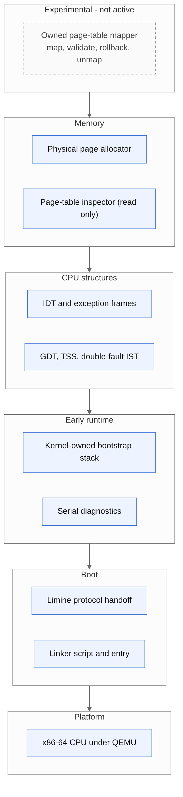
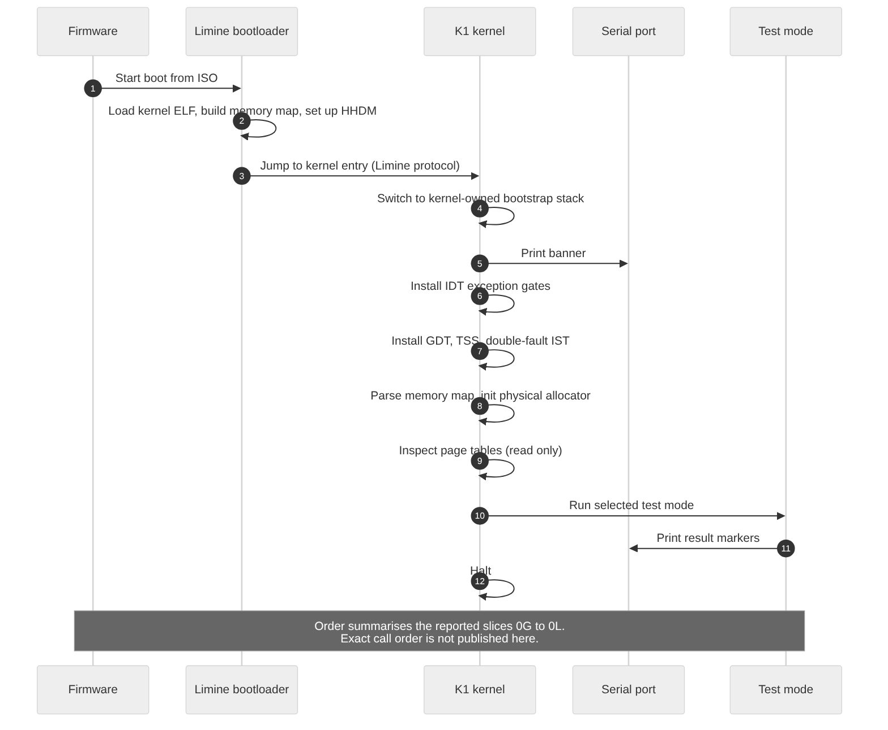
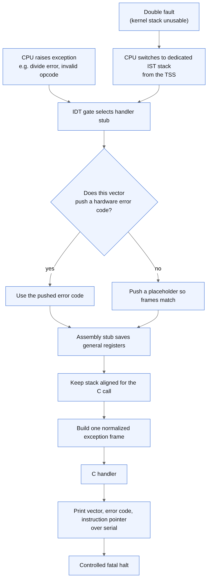
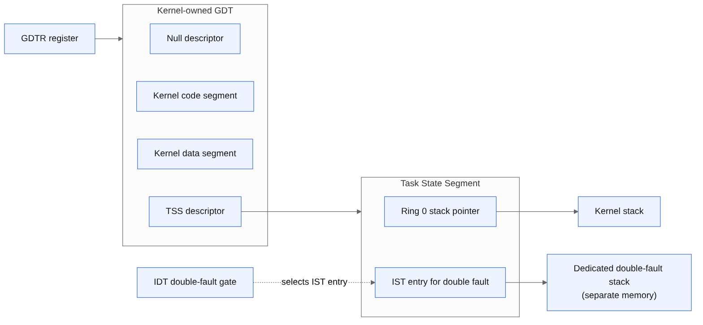

# 03. K1 kernel design

K1 is a freestanding C11 x86-64 kernel booted through the Limine protocol and tested under QEMU. This document explains what each part does and why it matters. It describes reported behavior; where a detail is a general property of the x86-64 architecture rather than something specific to K1, it is described as such.

## Layers

## What K1 does and does not do

| Does (reported) | Does not do yet |
|---|---|
| Boots via Limine and prints over serial | Safe address-space activation |
| Runs on its own bootstrap stack | Kernel heap |
| Handles CPU exceptions with normalized frames | Interrupts and timers |
| Has its own GDT, TSS and double-fault IST | Scheduler |
| Parses the memory map and allocates physical pages | System calls and userspace |
| Inspects four-level page tables read only | Storage, devices, graphics, networking |
| Has an experimental inactive page-table mapper | Application integration |

## Boot flow

### Bootloader handoff

Limine loads the kernel image, builds the memory map, enables a higher-half direct map (HHDM) of physical memory, and jumps to the kernel entry. The kernel relies on a pinned copy of the Limine protocol header so that its expectations match the bootloader assets it is built with.

### Linker script and entry

A linker script places the kernel at its intended addresses and names the entry point. In a freestanding kernel there is no operating system or C runtime beneath the code, so everything the kernel needs at the first instruction has to be arranged explicitly.

### Bootstrap stack

The bootloader leaves the CPU on a stack the kernel did not choose. Moving to a kernel-owned stack early means the kernel knows exactly where its stack is and how large it is, which is required before relying on exceptions.

### Serial diagnostics

Serial output is the kernel's first and most reliable way to report. It needs no graphics or drivers, and QEMU can capture it to a log, which is what the tests read.

## Exception handling

| Step | Why it exists |
|---|---|
| IDT gates for CPU exceptions | Without gates, a fault leads to a triple fault and reset |
| Placeholder where no error code is pushed | The CPU pushes a hardware error code for only some exceptions. A uniform frame lets one C handler serve all of them |
| Register preservation in assembly | The faulting context must be captured before C code changes it |
| Stack alignment | The C calling convention expects an aligned stack at the call |
| Normalized exception frame | One structure the handler can print and reason about |
| Controlled fatal handling | Print vector, error code and instruction pointer, then halt rather than continue in an unknown state |

Reported tests exercise divide-by-zero and invalid-opcode exceptions.

## GDT, TSS and double-fault IST

K1 installs its own Global Descriptor Table so it no longer depends on the bootloader's. A Task State Segment provides the Ring 0 stack pointer and Interrupt Stack Table entries. The double-fault handler is given a dedicated IST stack, so that even when the normal kernel stack is broken the CPU can still deliver the fault and the kernel can report it.

A double-fault delivery test is reported.

## Why the order matters

Exceptions, the GDT and the double-fault stack come before memory management on purpose. Memory code is where kernel bugs are most likely to cause faults, so the machinery that reports faults has to exist first.
