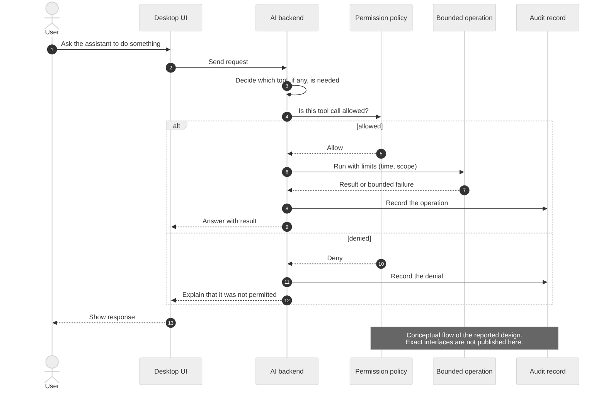

# 06. AI workspace and security model

## The core idea

An assistant that only answers questions is easy to trust. An assistant that can perform operations needs boundaries. ΛOS treats permissions, limits and auditability as design requirements of the AI workspace.

## Flow

This is the conceptual flow of the reported design. Exact interfaces, routes and tool names are not published in this showcase.

## What exists (reported)

| Mechanism | Purpose |
|---|---|
| AI backend foundation | Receives requests, talks to AI providers, selects tools |
| Permission policies | Decide whether a tool call is allowed |
| Bounded audit operations | Keep operations inside limits and record them |
| Failure handling | Errors are reported rather than hidden |

## What these mechanisms protect against

- An assistant taking an action nobody authorized.
- Unbounded operations that run too long or reach too far.
- Actions that leave no trace, which makes mistakes hard to find.

## What they do not protect against

- A flaw in the policy itself, or a route or tool the policy does not cover.
- A compromised host operating system. The assistant can only be as safe as the platform it acts on.
- Malicious or manipulated content that persuades the assistant to request an allowed but harmful action.
- Anything outside the trust boundary, such as a vulnerable dependency.

## Trust boundaries

| Boundary | Concern |
|---|---|
| User to desktop | Authentic user intent |
| Desktop to AI backend | Request integrity and data passed |
| AI backend to policy | Every tool call must be judged |
| Policy to system interfaces | The single path to the machine |
| Backend to AI provider | What data leaves the system |

## Secrets

Provider keys and tokens belong in environment configuration and are never published. This showcase contains no secrets, keys or environment values.

## Remaining gaps and honest limits

- No claim is made that the system is sandboxed, hardened, certified or enterprise-ready.
- No claim is made that every route and tool is protected by the policy.
- No external security audit has been done.
- Kernel isolation is not part of this model. K1 has no userspace yet, so there is no process isolation to rely on.
- Approval flows for sensitive operations, and session or conversation management, are design areas, not claimed features.

## Planned AI capabilities

Context-aware developer help, workspace organization, file and code discovery, diagnostic summaries, workflow automation, natural-language access to permitted operations, and search across user-authorized resources are all **planned**, not delivered.
