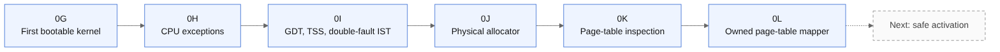

# 10. Development journey: slices 0G to 0L

Each slice is a small increment with an objective, an implementation, a verification and a remaining limitation. All entries are author-reported. No dates or commit identifiers are given because none are published here.

## Slice 0G: first bootable kernel
- **Objective:** boot a minimal freestanding kernel.
- **Implementation:** Limine boot, kernel entry, serial banner, ISO generation.
- **Verification:** bounded QEMU run.
- **Remaining:** nothing beyond boot.

## Slice 0H: CPU exception foundation
- **Objective:** survive and report CPU faults.
- **Implementation:** kernel-owned bootstrap stack, IDT gates, normalized exception frame, controlled fatal handling.
- **Verification:** divide-by-zero and invalid-opcode tests.
- **Remaining:** only some exceptions exercised.

## Slice 0I: GDT, TSS and double-fault IST
- **Objective:** a reliable path for the worst faults.
- **Implementation:** kernel-owned GDT, TSS, separate double-fault stack.
- **Verification:** double-fault delivery test.
- **Remaining:** no interrupts or user segments yet.

## Slice 0J: physical allocator
- **Objective:** manage physical memory safely.
- **Implementation:** memory-map processing, exclusions, page allocator, rejection of unsafe overlaps.
- **Verification:** allocation integration tests.
- **Remaining:** no kernel heap.

## Slice 0K: virtual-memory inspection
- **Objective:** understand paging without changing it.
- **Implementation:** four-level walker, effective permission inspection, HHDM and CR3 observations, kernel, stack and IST mapping inspection.
- **Verification:** runtime inspection under QEMU.
- **Remaining:** read only.

## Slice 0L: owned page-table construction
- **Objective:** build and manage a separate page-table hierarchy safely.
- **Implementation:** inactive hierarchy, controlled 4 KiB mappings, validation, W^X rejection, rollback, unmapping, safe recycling.
- **Verification:** seven reported QEMU test modes.
- **Remaining:** hierarchy not activated; no CPU access through it, no hardware NX fault, no live TLB validation.

## After 0L

The next planned step is safe address-space activation. If later slices exist, this document will be updated with them.
