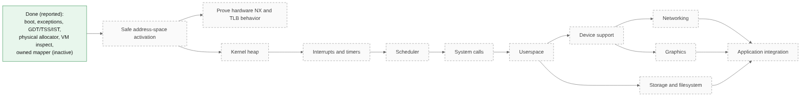

# 12. Roadmap

No dates are promised. Each milestone has a measurable acceptance idea.

## Immediate engineering milestones

| Milestone | Objective | Acceptance |
|---|---|---|
| Safe address-space activation | Switch to the owned hierarchy without losing the kernel | A test mode loads the hierarchy, keeps running and reports markers |
| Hardware NX proof | Show the CPU enforces no-execute | A deliberate execute on an NX page faults and is reported |
| TLB lifecycle | Correct invalidation when mappings change | Remap then access shows the new mapping, with a negative test |

## Kernel foundations

| Milestone | Acceptance |
|---|---|
| Kernel heap | Allocation, free and exhaustion tested |
| Interrupts and timers | Timer interrupts delivered and handled |
| Scheduler | Two kernel tasks alternate under test |
| System calls and userspace | A user-mode program runs and returns |
| Storage and filesystem | A file can be written and read back |

## Desktop and product integration

| Milestone | Acceptance |
|---|---|
| Platform decision recorded | A written decision with reasoning and a proof of concept |
| Desktop on the chosen platform | The desktop starts and is usable day to day |

## Browser and application compatibility

| Milestone | Acceptance |
|---|---|
| A mainstream browser runs on the chosen platform | Documented and reproducible |
| Existing software installable through established mechanisms | Documented and reproducible |

## AI functionality

| Milestone | Acceptance |
|---|---|
| Permitted operation end to end | Assistant performs an allowed action, audit record exists |
| Denied operation end to end | Denied action is refused and recorded |
| Context-aware developer help | Planned, to be defined |

## Security and reliability

| Milestone | Acceptance |
|---|---|
| Policy coverage review | Every tool path is listed and checked |
| Threat model written | Documented and reviewed |

## Release preparation

| Milestone | Acceptance |
|---|---|
| Reproducible builds | Same inputs produce the same artifacts |
| Published test evidence | Logs and hashes tied to a specific build |
